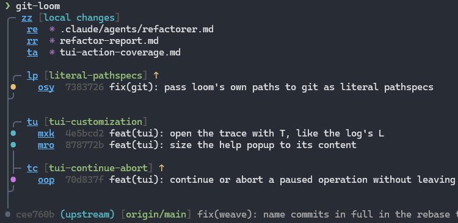

# 

*git-loom* weaves your feature branches into a single integration branch, so you can work on all of them at once — committing, amending, splitting and reordering — without ever switching branches. It is inspired by [jujutsu](https://github.com/martinvonz/jj) and [GitButler](https://gitbutler.com/).



## See It in Action

From the command line, with the status pinned on the left:

<video src="assets/git-loom-cli.mp4" controls muted playsinline preload="metadata" width="100%"></video>

The same operations from the interactive [`git loom tui`](commands/tui.md):

<video src="assets/git-loom-tui.mp4" controls muted playsinline preload="metadata" width="100%"></video>

## Core Concepts

### Integration Branch

The branch you work on. It tracks a remote branch (e.g. `origin/main`) and merges in all your feature branches, so you build and test them together. Create it with [`git loom init`](commands/init.md).

### Feature Branches

Independent branches woven into the integration branch, each pushed and reviewed on its own. You manage them from the integration branch:

- [`commit`](commands/commit.md) commits to a feature branch, creating it if needed
- [`fold`](commands/fold.md) amends, fixes up, or moves commits and files between branches
- [`push`](commands/push.md) pushes a branch and opens its pull request

> [!TIP]
> [`git loom commit -b <name>`](commands/commit.md) is the usual way to start a branch. [`git loom branch`](commands/branch.md) is for creating an empty branch ahead of time, or turning existing commits into one.

### Weaving

Each feature branch sits on the integration branch as a side branch joined by a merge, which is what `git loom status` draws. Every loom command rewrites history to keep that shape, so you never rebase by hand.

A rewrite keeps the modification time of files whose content did not change, so your build tool does not rebuild everything. Pause watcher-driven builds (`cargo watch`, build on save) while a loom command runs: they may compile half-rewritten files.

### Short IDs

`git loom status` labels every branch, commit and file with a short ID (`fa`, `mqt`, `ma`) that you type in other commands instead of hashes, names or paths.

Commit IDs are persistent: they come from a `Change-Id` trailer that loom adds to every commit it creates (see [`loom.changeId`](configuration.md#loomchangeid)), so they survive rewrites and you can chain commands on the same ID.

## Quick Start

```bash
# Create an integration branch from your main branch
git checkout main
git loom init

# Commit everything to a new feature branch, then add a second commit
git loom commit -b feature-auth -m "add login form" zz
git loom commit -b feature-auth -m "improve login form" zz

# See the branch-aware status
git loom

# Push the branch for review
git loom push feature-auth
```

Next: the [Tutorial](guides/tutorial.md), or [Working with AI Agents](guides/agents.md) to let Claude Code drive loom for you.
